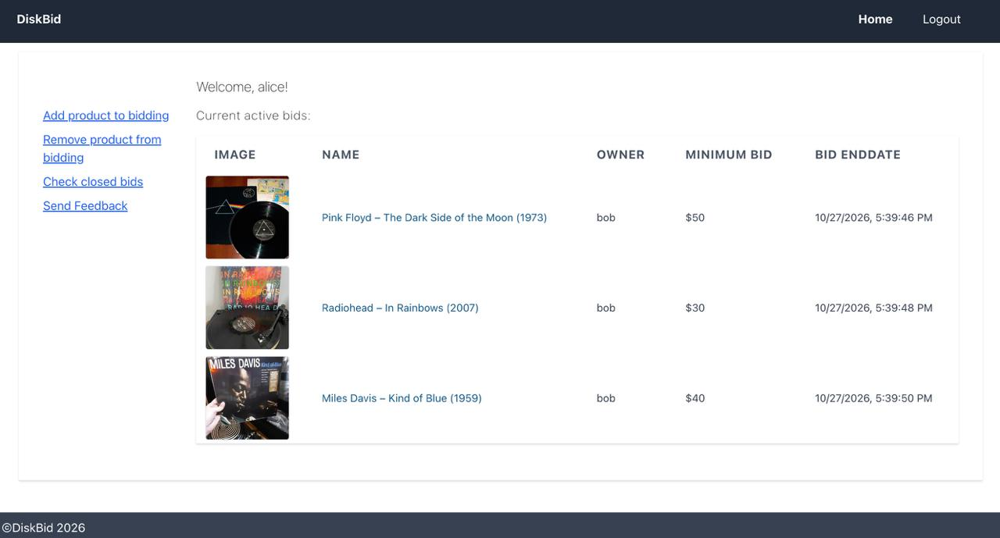
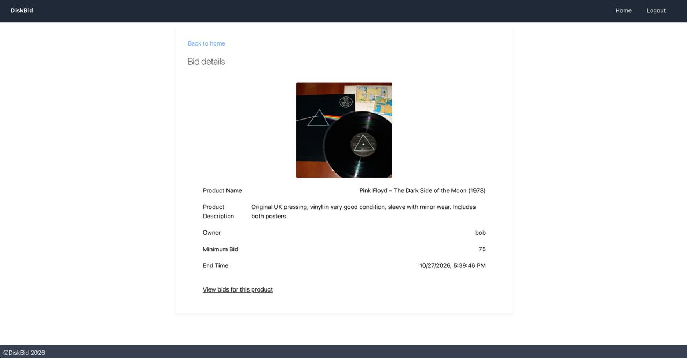
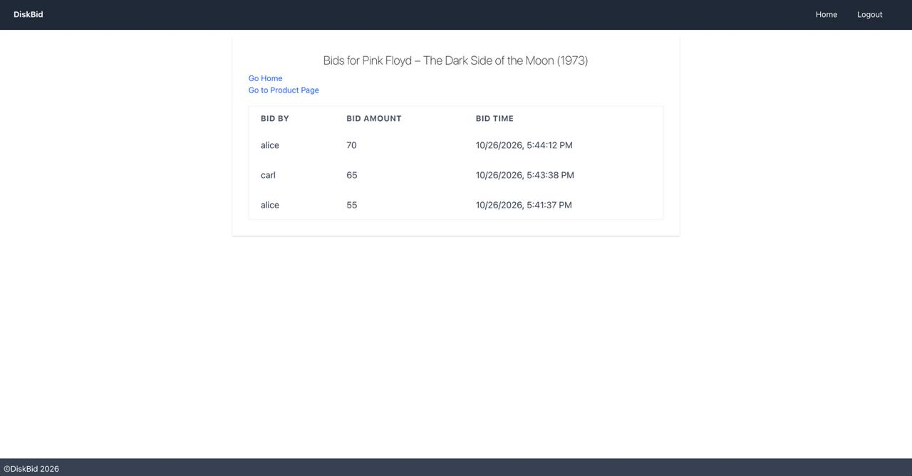
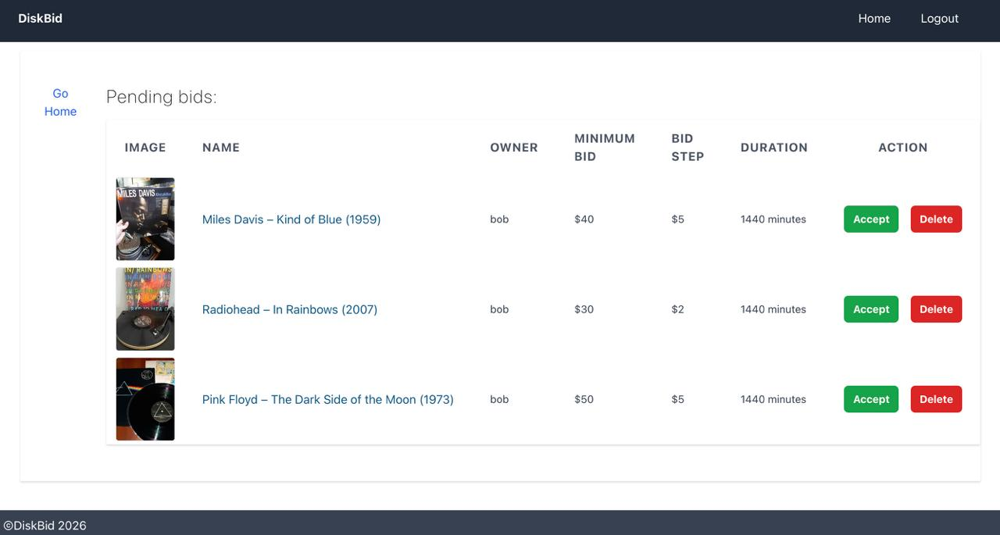

# diskbid

An online auction platform for vinyl records. Users list records with photos, place bids, and leave feedback. Moderators and admins manage listings.




## Screenshots

| Listing                                  | Bid history                        |
| ---------------------------------------- | ---------------------------------- |
|  |  |

**Admin: approving pending listings**



## Tech stack

- **Backend:** Java 11, Spring Boot 2.6 (Web, Data JPA, Security), JWT authentication, PostgreSQL
- **Frontend:** React 17, Axios

## Features

- REST API (`/api/v1/auth`, `/api/v1/bids`, `/api/v1/feedbacks`)
- Sign-up and login with JWT, and role-based access (user, moderator, admin)
- Auction listings with image upload (multipart) and image serving
- Pending, active and closed auctions with bid history and results
- User feedback

## Run locally

**Requirements:** Java 11+, Node.js, PostgreSQL running on `localhost:5432`

**Backend**

```bash
cd diskbid
export DB_PASSWORD=your_db_password
export JWT_SECRET=$(openssl rand -base64 64)
./mvnw spring-boot:run
```

Uploaded images are stored in the directory set by `file.productimages.dir` in `application.properties`.

**Frontend**

```bash
cd diskbid-ui
npm install
npm start
```

